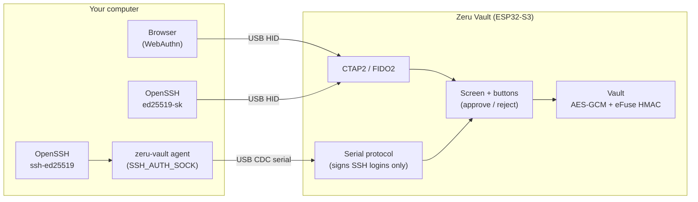

# Zeru Vault

[🇧🇷 Português](README.md) · 🇺🇸 English

**Zeru Vault** turns an inexpensive **LilyGO T-Display-S3** (ESP32-S3) board into an open-source **hardware security key** with its own screen and buttons:

- a **FIDO2 / WebAuthn** authenticator for **passkeys** in Chrome, Brave, Edge and Firefox;
- a **FIDO2 SSH key** for OpenSSH (`ssh-keygen -t ed25519-sk` / `ecdsa-sk`);
- a **classic SSH agent** (`ssh-ed25519`) with keys that never leave the device.

Every signature is shown on the device (website, SSH user, server host key, which key will sign) and has to be **approved with the physical buttons**. Private keys are generated by the chip's hardware random number generator, encrypted with a key **bound to the chip's eFuses**, and can never be exported.

<p align="center">
  
</p>

---

## Contents

- [Screens](#screens)
- [Hardware](#hardware)
- [Features](#features)
- [How it works](#how-it-works)
- [Controls](#controls)
- [Quick start](#quick-start)
- [Using it](#using-it)
- [Security](#security)
- [FAQ & troubleshooting](#faq--troubleshooting)
- [Development](#development)
- [License](#license)

---

## Screens

These images are rendered from the real firmware UI code (`make screenshots`), pixel for pixel.

| | |
| :---: | :---: |
| <br>First start | <br>PIN entry with the drum (6–8 digits) |
| <br>Backup notice after setup | <br>Locked |
| <br>Keys, with the **ACTIVE** one exposed to the computer | <br>Fingerprint (compare with `ssh-keygen -l`) |
| <br>SSH login: **Reject** is preselected | <br>Select **Approve** and press both buttons |
| <br>Passkey sign-in with an account picker | <br>Creating a passkey |
| <br>OpenSSH FIDO2 key (`ed25519-sk`) | <br>Long domains are cut **from the left**, so the real domain stays visible |
| <br>Settings | <br>Passkeys stored on the active key |
| <br>About: protection status and session | <br>Destructive actions need an explicit choice |

---

## Hardware

| Board | Display | Buttons | USB |
| :--- | :--- | :--- | :--- |
| **LilyGO T-Display-S3**, non-touch, ESP32-S3R8 (16 MB flash, 8 MB PSRAM) | 1.9" ST7789, 170×320 IPS | `GPIO 14` (**Up**) and `GPIO 0` / BOOT (**Down**) | Native USB-C: FIDO2 HID + CDC serial |

**Where to buy:** [LilyGO T-Display-S3 on AliExpress](https://s.click.aliexpress.com/e/_c3Asebzt)

> **Affiliate link disclosure:** the link above is an **AliExpress affiliate link**. If you buy through it, the project maintainer may receive a small commission, **at no extra cost to you**. You can find the same board from any seller; nothing in this project depends on where you buy it. Choose the **non-touch, 16 MB / 8 MB** version, which is the one this firmware is tested on.

Nothing else is needed: no soldering, no extra parts. A USB-C cable with data lines is enough. A small case is recommended so the buttons are easy to press and the board is protected.

---

## Features

**Security**

- **On-device PIN (6–8 digits)**, typed with the buttons, never over USB. The drum starts at a random digit every time, so someone watching your fingers cannot count presses.
- **Keys bound to the chip.** Keys are encrypted with AES-256-GCM under a random vault key. That key is wrapped by `HMAC_eFuse(PBKDF2(PIN))`. The HMAC key lives in a read-protected eFuse, so a copy of the flash is useless on its own.
- **Brute-force protection:** 10 attempts, growing cooldown after 3 errors, and a full physical erase of the vault on the 10th.
- **Honest approvals:** every request names what it is for, *Reject* is preselected, buttons are ignored for the first 0.7 s, and a gesture that started before the request appeared is discarded.
- **Auto-lock that malware cannot postpone:** 15 minutes without a button press, 12 hours at most. USB traffic never keeps the vault unlocked.
- **No firmware updates over USB without you:** the USB "auto-reset into bootloader" path is disabled; flashing requires pressing BOOT + RST.
- **Secure deletion:** deleting a key or passkey, changing the PIN or resetting passkeys rewrites the storage so old encrypted data is physically erased.

**FIDO2 / passkeys**

- CTAP 2.0 over USB HID, `ES256` (P-256) and `EdDSA` (Ed25519), following the site's preference order.
- **Passkeys** (discoverable credentials, up to 24), several accounts per site, account picker on the screen.
- **OpenSSH FIDO2 keys** (`ed25519-sk`, `ecdsa-sk`, with or without `-O resident`).
- Browser **Reset security key** support, plus *Settings → Reset passkeys* on the device.
- If a site asks while the vault is locked, the device asks for the PIN and **continues the same request**.
- If the passkey is on another of your keys, the device tells you which one to activate.

**SSH agent**

- Up to **8 named Ed25519 keys**; only the **ACTIVE** one is visible to the computer. The choice survives reboots.
- Zero-dependency Python agent (`SSH_AUTH_SOCK`) installed as a `systemd --user` service.
- Desktop notification when a login waits for you; waits for you to unlock instead of failing.
- Shows the **remote user** and the **server host-key fingerprint** (OpenSSH 8.9+ "hostbound" logins) before signing.

---

## How it works



1. The computer sends a request: a WebAuthn challenge, or an SSH `userauth` blob.
2. The firmware checks that the request is well formed and belongs to the **active** key. Arbitrary data is never signed.
3. The screen shows what is being approved. Nothing happens until you select *Approve* and press both buttons.
4. The private key is decrypted in RAM only for that signature and wiped right after.

FIDO2 credentials are derived from the active key's seed per website, so they also never leave the device.

---

## Controls

The same two gestures work everywhere: menus, PIN entry and approval screens.

| Gesture | Effect |
| :--- | :--- |
| **Up** / **Down** | Move the selection. In menus, holding repeats; on approval and delete screens it does not. |
| **Press both** (any order, any delay between fingers) | Confirm the selected option |
| **Hold both** (0.8 s) | Back / cancel / lock. On an approval screen it **rejects**. |

The side rail always shows what each button does right now. On the lock screen, **holding both** opens *Factory reset* (it asks for confirmation; useful if you forgot the PIN).

---

## Quick start

### 1. Install the toolchain (once)

```bash
arduino-cli core install esp32:esp32@3.3.11
arduino-cli lib install "GFX Library for Arduino@1.6.7"
```

### 2. Build and flash

```bash
make build
make flash
```

`make flash` saves a backup of the vault storage, then asks you to put the board in download mode: **hold BOOT (the button labelled *Down* on screen), tap RST, release BOOT**, and press Enter. It writes only the firmware, never the vault data. Tap **RST** when it finishes.

Upgrading from firmware 1.x keeps your keys and passkeys: they are migrated and bound to the chip the first time you unlock.

### 3. Set up the device

1. Press both buttons on the welcome screen and create a **6–8 digit PIN** (8 digits recommended).
2. Read the backup notice. Keys cannot be exported, so **register a second security key** (or keep recovery codes) on every account.
3. Choose **`+ New key`**, type a name (e.g. `GITHUB`) and select **`OK`**. The key is generated on the chip and becomes **ACTIVE**.

---

## Using it

### Which SSH mode should I use?

| | **FIDO2 key** (`ed25519-sk`) | **Classic agent** (`ssh-ed25519`) |
| :--- | :--- | :--- |
| Host software | None (OpenSSH 8.2+) | `zeru-vault` agent (Python, Linux) |
| Server requirement | OpenSSH 8.2+ | Any SSH server |
| Shows on screen | `ssh:` application | Remote user + server host key |
| Key file on disk | A small *handle* file (useless without the device) | Nothing |

#### Option A: FIDO2 security key

```bash
ssh-keygen -t ed25519-sk -O resident -f ~/.ssh/id_zeru_vault_sk
ssh-copy-id -i ~/.ssh/id_zeru_vault_sk.pub user@server
ssh -i ~/.ssh/id_zeru_vault_sk user@server
```

With `-O resident` you can recover the handle on a new computer with `ssh-keygen -K`.

#### Option B: classic SSH agent

```bash
make install-service   # systemd --user agent + default IdentityAgent in ~/.ssh/config
make install-udev      # optional (sudo): desktop-user access, keeps ModemManager away
make pubkey            # prints the public key for ~/.ssh/authorized_keys
make status            # device, firmware, lock state, active key, agent socket
make test              # sends a test login to the device
```

Then just `ssh user@server`. The agent's block is appended to the **end** of `~/.ssh/config`, so your own `Host` entries keep priority. A backup is saved as `~/.ssh/config.zeru-vault.bak`; `make uninstall-service` removes the service and the block.

### Passkeys in the browser

1. On the site, choose **Security key** or **Use a passkey** (and *USB security key* if asked).
2. If the vault is locked, enter the PIN on the device; the request continues by itself.
3. Check the **domain**, pick the account if there are several, select **Sign in** and press both buttons.

Passkeys belong to the key that was **ACTIVE** when you created them. Manage them in *Settings → Passkeys*.

---

## Security

A short summary; the full threat model, cryptographic design and residual risks are in [SECURITY.en.md](SECURITY.en.md).

| Threat | Protection |
| :--- | :--- |
| Malware on your computer asks for signatures | Each one needs your approval on the device; silent FIDO2 requests are answered with the *user present* and *user verified* flags cleared |
| Malware tries to keep the vault unlocked | Auto-lock counts physical button presses only |
| Malware tries to flash a backdoored firmware | USB auto-reset into the bootloader is disabled |
| Someone copies the flash chip | Keys are wrapped by a secret burned into the chip's eFuses |
| Someone guesses the PIN | 10 attempts, then the vault is erased |

**Residual risk to know about:** without *Secure Boot*, a person who keeps your device for a long time can flash their own firmware and guess the PIN **on the chip** (about 0.9 s per guess, ignoring the 10-attempt limit): around 10 days for a 6-digit PIN and around 3 years for 8 digits. Use **8 digits** for important keys. Enabling Secure Boot v2 + Flash Encryption removes this risk; it is an optional, **irreversible** step described in [SECURITY.en.md → Optional hardening](SECURITY.en.md#optional-hardening-secure-boot-v2--flash-encryption).

> The first setup **burns one eFuse key block** on the ESP32-S3. This is permanent, but the board stays fully usable for any other firmware.

---

## FAQ & troubleshooting

<details>
<summary><b>I forgot my PIN.</b></summary>

On the lock screen, **hold both buttons** and confirm *Erase device*. Everything on the device is destroyed (that is the point); set it up again and use your second key or recovery codes to get back into your accounts.
</details>

<details>
<summary><b>I lost the device. Can someone use it?</b></summary>

Not without the PIN: 10 wrong attempts erase it. Still, remove its public key from your servers and its passkeys from your accounts using your backup key. See the residual risk above if the attacker has a lot of time.
</details>

<details>
<summary><b><code>make flash</code> says it cannot connect.</b></summary>

The device must be in download mode: hold **BOOT** (the *Down* button), tap **RST**, release BOOT. The screen goes dark. This is intentional: the firmware does not let the computer reboot it into the bootloader.
</details>

<details>
<summary><b><code>make status</code> says the device was not found or the port is busy.</b></summary>

Check that the cable carries data. If `ModemManager` is installed it may grab the serial port: run `make install-udev`. Only one program can talk to the device at a time (the agent opens the port only while it is working).
</details>

<details>
<summary><b>A site says my passkey does not exist.</b></summary>

Passkeys belong to the key that was ACTIVE when they were created. The device shows *Passkey on other key* and tells you which key to activate.
</details>

<details>
<summary><b>Does <code>ssh-keygen -O verify-required</code> work?</b></summary>

No. The device verifies you with its own on-screen PIN when you unlock it, but it does not implement the CTAP *clientPIN* protocol that `verify-required` uses. Use the default `ed25519-sk` key.
</details>

<details>
<summary><b>Does it work on macOS or Windows?</b></summary>

Passkeys and `ed25519-sk` keys use the standard FIDO2 USB protocol and work wherever your browser or OpenSSH supports security keys. The classic SSH agent (`agent/ssh_vault_agent.py`) is Linux-only.
</details>

<details>
<summary><b>Can I back up my keys?</b></summary>

No, by design: like a YubiKey, keys are created on the chip and cannot be read out. Register two security keys on every account.
</details>

---

## Development

```bash
make build         # compile with all warnings
make flash         # NVS-preserving flash (see above)
make test          # end-to-end SSH signature test on the device
make screenshots   # render docs/images/*.png from the real UI code on your PC
```

`make screenshots` compiles `firmware/ui.cpp` and `firmware/buttons.cpp` together with the real *GFX Library for Arduino* on your computer, presses the buttons in a scripted session and saves every screen (needs `g++` and Python Pillow). Use it to review UI changes without flashing.

```text
.
├── Makefile                  # build, flash, service, udev, test and screenshot targets
├── firmware/
│   ├── firmware.ino          # entry point, main loop and auto-lock
│   ├── vault.h / vault.cpp   # eFuse-HMAC KEK, vault key wrapping, AES-GCM, passkeys, secure erase
│   ├── fido2.h / fido2.cpp   # CTAP2 over USB HID (ES256 + EdDSA, passkeys, reset)
│   ├── sshparse.h / .cpp     # strict RFC 4252 / hostbound SSH userauth parser
│   ├── comm.h / comm.cpp     # USB serial protocol for the SSH agent
│   ├── buttons.h / .cpp      # debounced two-button gestures
│   ├── ui.h / ui.cpp         # 30 FPS canvas UI
│   └── fonts/                # bitmap fonts (GNU FreeFont, see fonts/LICENSE.md)
├── agent/ssh_vault_agent.py  # zero-dependency SSH agent and installer
├── tools/ui-sim/             # host renderer used by `make screenshots`
├── udev/70-zeru-vault.rules  # desktop-user access + ModemManager exclusion
└── docs/images/              # screenshots used in this README
```

See [CONTRIBUTING.en.md](CONTRIBUTING.en.md) for code rules and security invariants.

---

## License

The source code is released under the [MIT License](LICENSE).

The compiled firmware also contains third-party components, listed in [THIRD-PARTY-NOTICES.en.md](THIRD-PARTY-NOTICES.en.md). In particular, the bitmap fonts in `firmware/fonts/` are derived from GNU FreeFont (GPL-3.0-or-later with font exception), so **a distributed firmware binary should be treated as GPL-3.0-or-later** (see [`firmware/fonts/LICENSE.md`](firmware/fonts/LICENSE.md)).
