# Zeru Vault

🇧🇷 Português · [🇺🇸 English](README.en.md)

[](https://github.com/thiegocarvalho/zeru-vault/actions/workflows/build.yml)
[](LICENSE)
[](https://github.com/thiegocarvalho/zeru-vault)
[](#hardware)
[](https://fidoalliance.org/fido2/)
[](https://www.openssh.com/)
[](https://github.com/espressif/arduino-esp32)
[](https://github.com/thiegocarvalho/zeru-vault/commits/main)

O **Zeru Vault** transforma uma placa barata **LilyGO T-Display-S3** (ESP32-S3) numa **chave de segurança física** de código aberto, com tela e botões próprios:

- um autenticador **FIDO2 / WebAuthn** para **passkeys** no Chrome, Brave, Edge e Firefox;
- uma **chave SSH FIDO2** para o OpenSSH (`ssh-keygen -t ed25519-sk` / `ecdsa-sk`);
- um **agente SSH clássico** (`ssh-ed25519`) cujas chaves nunca saem do dispositivo.

Toda assinatura aparece na tela (site, usuário SSH, chave do servidor e qual chave vai assinar) e precisa ser **aprovada nos botões físicos**. As chaves privadas são geradas pelo gerador de números aleatórios em hardware do chip, cifradas com uma chave **presa aos eFuses do chip** e nunca podem ser exportadas.

<p align="center">
  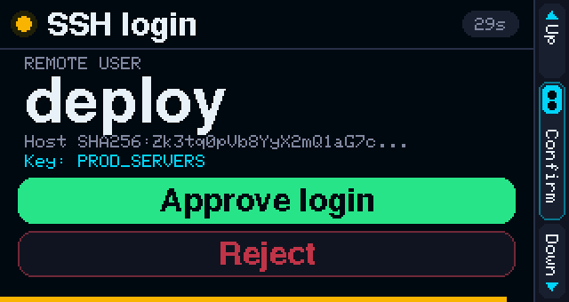
</p>

---

## Sumário

- [Telas](#telas)
- [Hardware](#hardware)
- [Recursos](#recursos)
- [Como funciona](#como-funciona)
- [Controles](#controles)
- [Primeiros passos](#primeiros-passos)
- [Como usar](#como-usar)
- [Segurança](#segurança)
- [Perguntas frequentes e solução de problemas](#perguntas-frequentes-e-solução-de-problemas)
- [Desenvolvimento](#desenvolvimento)
- [Licença](#licença)

---

## Telas

Estas imagens são geradas a partir do código real da interface do firmware (`make screenshots`), pixel a pixel. A interface do dispositivo é em inglês.

| | |
| :---: | :---: |
| 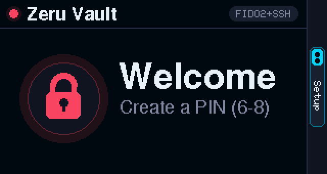<br>Primeiro uso | 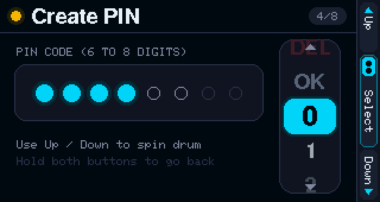<br>PIN digitado no tambor (6 a 8 dígitos) |
| 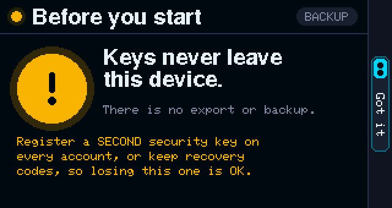<br>Aviso de backup após a configuração | 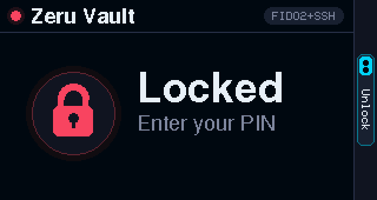<br>Bloqueado |
| 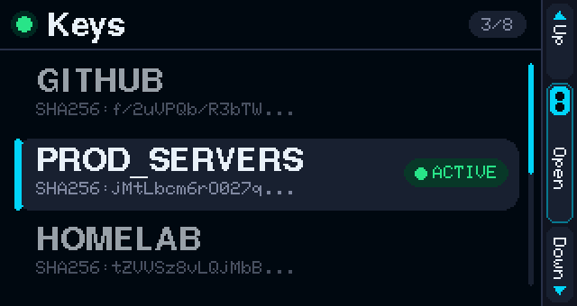<br>Chaves; a marcada como **ACTIVE** é a exposta ao computador | 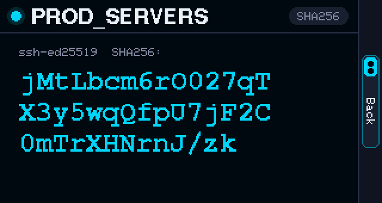<br>Impressão digital (compare com `ssh-keygen -l`) |
| 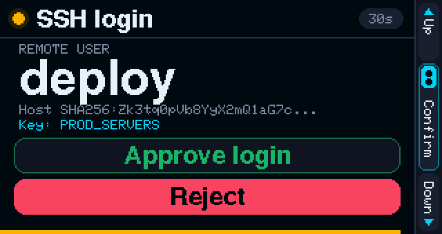<br>Login SSH: **Reject** já vem selecionado | <br>Selecione **Approve** e aperte os dois botões |
| <br>Entrar com passkey, escolhendo a conta | <br>Criando uma passkey |
| 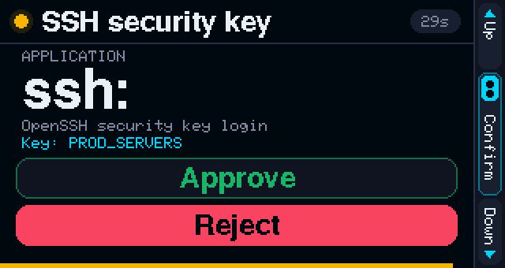<br>Chave FIDO2 do OpenSSH (`ed25519-sk`) | 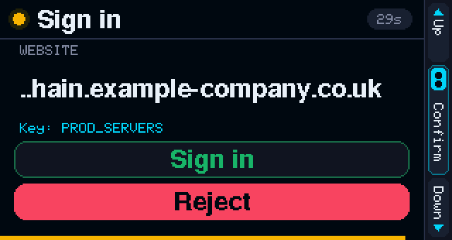<br>Domínios longos são cortados **pela esquerda**, para o domínio real continuar visível |
| 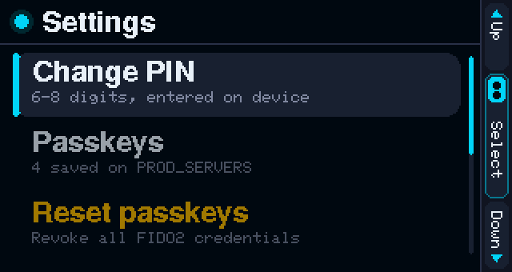<br>Configurações | <br>Passkeys guardadas na chave ativa |
| 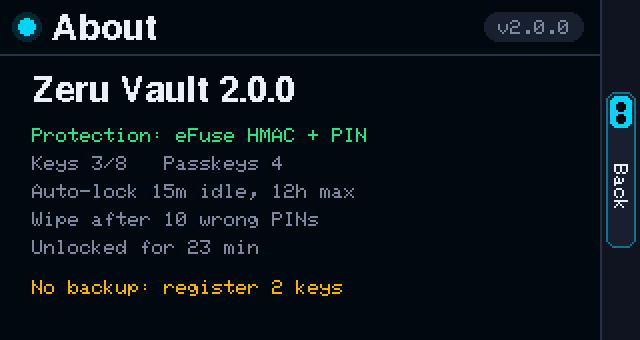<br>Sobre: estado da proteção e da sessão | 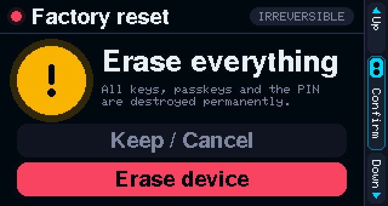<br>Ações destrutivas exigem uma escolha explícita |

---

## Hardware

| Placa | Tela | Botões | USB |
| :--- | :--- | :--- | :--- |
| **LilyGO T-Display-S3**, sem touch, ESP32-S3R8 (16 MB de flash, 8 MB de PSRAM) | ST7789 de 1,9", 170×320 IPS | `GPIO 14` (**Up**) e `GPIO 0` / BOOT (**Down**) | USB-C nativo: FIDO2 HID + serial CDC |

**Onde comprar:** [LilyGO T-Display-S3 no AliExpress](https://s.click.aliexpress.com/e/_c3Asebzt)

> **Aviso sobre link de afiliado:** o link acima é um **link de afiliado do AliExpress**. Se você comprar por ele, o mantenedor do projeto pode receber uma pequena comissão, **sem nenhum custo extra para você**. A mesma placa pode ser comprada de qualquer vendedor; nada neste projeto depende de onde você compra. Escolha a versão **sem touch, 16 MB / 8 MB**, que é a testada com este firmware.

Não é preciso mais nada: sem solda, sem peças extras. Basta um cabo USB-C que transmita dados. Uma caixinha (case) é recomendada para proteger a placa e facilitar o uso dos botões.

---

## Recursos

**Segurança**

- **PIN digitado no próprio dispositivo (6 a 8 dígitos)**, pelos botões, nunca pela USB. O tambor começa num dígito aleatório a cada vez, então quem observa seus dedos não consegue contar os toques.
- **Chaves presas ao chip.** As chaves são cifradas com AES-256-GCM sob uma chave aleatória do cofre. Essa chave é protegida por `HMAC_eFuse(PBKDF2(PIN))`. A chave HMAC fica num eFuse protegido contra leitura, então uma cópia da memória flash sozinha não serve para nada.
- **Proteção contra força bruta:** 10 tentativas, espera crescente a partir do 3º erro e apagamento físico completo do cofre no 10º.
- **Aprovações honestas:** cada pedido diz para que serve, *Reject* vem pré-selecionado, os botões são ignorados nos primeiros 0,7 s e um gesto iniciado antes de o pedido aparecer é descartado.
- **Bloqueio automático que malware não consegue adiar:** 15 minutos sem apertar botão, no máximo 12 horas de sessão. Tráfego USB nunca mantém o cofre aberto.
- **Nada de atualização de firmware pela USB sem você:** o caminho de "reiniciar no bootloader" pela USB está desativado; para gravar é preciso apertar BOOT + RST.
- **Apagamento seguro:** apagar uma chave ou passkey, trocar o PIN ou redefinir as passkeys regrava o armazenamento, apagando fisicamente os dados cifrados antigos.

**FIDO2 / passkeys**

- CTAP 2.0 sobre USB HID, `ES256` (P-256) e `EdDSA` (Ed25519), seguindo a ordem de preferência do site.
- **Passkeys** (credenciais detectáveis, até 24), várias contas por site e escolha da conta na tela.
- **Chaves FIDO2 do OpenSSH** (`ed25519-sk`, `ecdsa-sk`, com ou sem `-O resident`).
- Suporte ao **Redefinir chave de segurança** do navegador, além de *Settings → Reset passkeys* no próprio dispositivo.
- Se um site pedir algo com o cofre bloqueado, o dispositivo pede o PIN e **continua o mesmo pedido**.
- Se a passkey estiver em outra das suas chaves, o dispositivo avisa qual chave ativar.

**Agente SSH**

- Até **8 chaves Ed25519 com nome**; só a marcada como **ACTIVE** fica visível para o computador. A escolha sobrevive a reinicializações.
- Agente em Python sem dependências (`SSH_AUTH_SOCK`), instalado como serviço `systemd --user`.
- Notificação na área de trabalho quando um login espera por você; espera o desbloqueio em vez de falhar.
- Mostra o **usuário remoto** e a **impressão digital da chave do servidor** (logins "hostbound" do OpenSSH 8.9+) antes de assinar.

---

## Como funciona

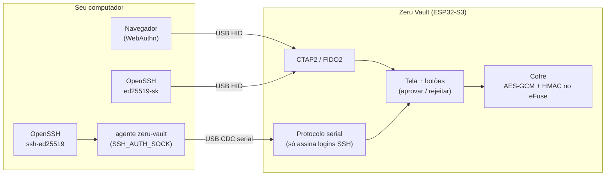

1. O computador envia um pedido: um desafio WebAuthn ou um bloco `userauth` do SSH.
2. O firmware confere se o pedido está bem formado e se é para a chave **ativa**. Dados arbitrários nunca são assinados.
3. A tela mostra o que está sendo aprovado. Nada acontece até você selecionar *Approve* e apertar os dois botões.
4. A chave privada só é decifrada na RAM para aquela assinatura e apagada logo em seguida.

As credenciais FIDO2 são derivadas da semente da chave ativa, uma por site, então também nunca saem do dispositivo.

---

## Controles

Os mesmos dois gestos funcionam em todo lugar: menus, digitação do PIN e telas de aprovação.

| Gesto | Efeito |
| :--- | :--- |
| **Up** / **Down** | Move a seleção. Nos menus, segurar repete; nas telas de aprovação e de exclusão, não. |
| **Apertar os dois** (em qualquer ordem, com qualquer atraso entre os dedos) | Confirma a opção selecionada |
| **Segurar os dois** (0,8 s) | Voltar / cancelar / bloquear. Numa tela de aprovação, **rejeita**. |

A barra lateral sempre mostra o que cada botão faz naquele momento. Na tela de bloqueio, **segurar os dois** abre o *Factory reset* (pede confirmação; útil se você esqueceu o PIN).

---

## Primeiros passos

### 1. Instale as ferramentas (uma vez)

```bash
arduino-cli core install esp32:esp32@3.3.11
arduino-cli lib install "GFX Library for Arduino@1.6.7"
```

### 2. Compile e grave

```bash
make build
make flash
```

O `make flash` salva uma cópia do armazenamento do cofre e pede que você coloque a placa em modo de gravação: **segure o BOOT (o botão marcado *Down* na tela), toque no RST, solte o BOOT** e aperte Enter. Ele grava só o firmware, nunca os dados do cofre. Quando terminar, toque no **RST**.

Atualizar a partir do firmware 1.x mantém suas chaves e passkeys: elas são migradas e presas ao chip no primeiro desbloqueio.

### 3. Configure o dispositivo

1. Aperte os dois botões na tela de boas-vindas e crie um **PIN de 6 a 8 dígitos** (recomendamos 8).
2. Leia o aviso de backup. As chaves não podem ser exportadas, então **registre uma segunda chave de segurança** (ou guarde os códigos de recuperação) em cada conta.
3. Escolha **`+ New key`**, digite um nome (por exemplo `GITHUB`) e selecione **`OK`**. A chave é gerada no chip e passa a ser a **ACTIVE**.

---

## Como usar

### Qual modo SSH usar?

| | **Chave FIDO2** (`ed25519-sk`) | **Agente clássico** (`ssh-ed25519`) |
| :--- | :--- | :--- |
| Software no computador | Nenhum (OpenSSH 8.2+) | Agente `zeru-vault` (Python, Linux) |
| Exigência no servidor | OpenSSH 8.2+ | Qualquer servidor SSH |
| O que aparece na tela | Aplicação `ssh:` | Usuário remoto + chave do servidor |
| Arquivo de chave no disco | Um pequeno arquivo *identificador* (inútil sem o dispositivo) | Nenhum |

#### Opção A: chave de segurança FIDO2

```bash
ssh-keygen -t ed25519-sk -O resident -f ~/.ssh/id_zeru_vault_sk
ssh-copy-id -i ~/.ssh/id_zeru_vault_sk.pub usuario@servidor
ssh -i ~/.ssh/id_zeru_vault_sk usuario@servidor
```

Com `-O resident`, dá para recuperar o identificador num computador novo com `ssh-keygen -K`.

#### Opção B: agente SSH clássico

```bash
make install-service   # agente systemd --user + IdentityAgent padrão no ~/.ssh/config
make install-udev      # opcional (sudo): acesso do usuário da sessão e afasta o ModemManager
make pubkey            # mostra a chave pública para o ~/.ssh/authorized_keys
make status            # dispositivo, firmware, bloqueio, chave ativa, socket do agente
make test              # envia um login de teste para o dispositivo
```

Depois é só `ssh usuario@servidor`. O bloco do agente é adicionado ao **final** do `~/.ssh/config`, então suas entradas `Host` continuam tendo prioridade. Uma cópia de segurança fica em `~/.ssh/config.zeru-vault.bak`; o `make uninstall-service` remove o serviço e o bloco.

### Passkeys no navegador

1. No site, escolha **Chave de segurança** ou **Usar uma passkey** (e *chave de segurança USB*, se perguntar).
2. Se o cofre estiver bloqueado, digite o PIN no dispositivo; o pedido continua sozinho.
3. Confira o **domínio**, escolha a conta se houver mais de uma, selecione **Sign in** e aperte os dois botões.

As passkeys pertencem à chave que estava **ACTIVE** quando foram criadas. Gerencie-as em *Settings → Passkeys*.

---

## Segurança

Um resumo; o modelo de ameaças completo, o desenho criptográfico e os riscos residuais estão no [SECURITY.md](SECURITY.md).

| Ameaça | Proteção |
| :--- | :--- |
| Malware no computador pede assinaturas | Cada uma precisa da sua aprovação no dispositivo; pedidos FIDO2 silenciosos recebem as flags de *usuário presente* e *usuário verificado* zeradas |
| Malware tenta manter o cofre aberto | O bloqueio automático só conta botões físicos |
| Malware tenta gravar um firmware adulterado | O reinício automático no bootloader pela USB está desativado |
| Alguém copia o chip de memória flash | As chaves dependem de um segredo gravado nos eFuses do chip |
| Alguém tenta adivinhar o PIN | 10 tentativas, depois o cofre é apagado |

**Risco residual que você precisa conhecer:** sem *Secure Boot*, quem ficar muito tempo com seu dispositivo pode gravar o próprio firmware e tentar adivinhar o PIN **no chip** (cerca de 0,9 s por tentativa, ignorando o limite de 10): uns 10 dias para um PIN de 6 dígitos e uns 3 anos para 8 dígitos. Use **8 dígitos** nas chaves importantes. Ativar Secure Boot v2 + Flash Encryption elimina esse risco; é um passo opcional e **irreversível**, descrito em [SECURITY.md → Endurecimento opcional](SECURITY.md#endurecimento-opcional-secure-boot-v2--flash-encryption).

> A primeira configuração **grava um bloco de chave nos eFuses** do ESP32-S3. Isso é permanente, mas a placa continua totalmente utilizável com qualquer outro firmware.

---

## Perguntas frequentes e solução de problemas

<details>
<summary><b>Esqueci meu PIN.</b></summary>

Na tela de bloqueio, **segure os dois botões** e confirme *Erase device*. Tudo no dispositivo é destruído (é essa a ideia); configure-o de novo e use sua segunda chave ou seus códigos de recuperação para voltar às suas contas.
</details>

<details>
<summary><b>Perdi o dispositivo. Alguém consegue usá-lo?</b></summary>

Não sem o PIN: 10 tentativas erradas apagam tudo. Mesmo assim, remova a chave pública dele dos seus servidores e as passkeys dele das suas contas usando sua chave reserva. Veja o risco residual acima caso o atacante tenha muito tempo.
</details>

<details>
<summary><b>O <code>make flash</code> diz que não consegue conectar.</b></summary>

O dispositivo precisa estar em modo de gravação: segure o **BOOT** (o botão *Down*), toque no **RST** e solte o BOOT. A tela apaga. Isso é proposital: o firmware não deixa o computador reiniciá-lo no bootloader.
</details>

<details>
<summary><b>O <code>make status</code> diz que o dispositivo não foi encontrado ou que a porta está ocupada.</b></summary>

Confira se o cabo transmite dados. Se o `ModemManager` estiver instalado, ele pode tomar a porta serial: rode `make install-udev`. Só um programa por vez conversa com o dispositivo (o agente só abre a porta enquanto está trabalhando).
</details>

<details>
<summary><b>Um site diz que minha passkey não existe.</b></summary>

As passkeys pertencem à chave que estava ACTIVE quando foram criadas. O dispositivo mostra *Passkey on other key* e diz qual chave ativar.
</details>

<details>
<summary><b>O <code>ssh-keygen -O verify-required</code> funciona?</b></summary>

Não. O dispositivo verifica você com o PIN digitado na própria tela ao desbloquear, mas não implementa o protocolo CTAP *clientPIN* que o `verify-required` usa. Use a chave `ed25519-sk` padrão.
</details>

<details>
<summary><b>Funciona no macOS ou no Windows?</b></summary>

Passkeys e chaves `ed25519-sk` usam o protocolo FIDO2 padrão por USB e funcionam onde o navegador ou o OpenSSH suportarem chaves de segurança. O agente SSH clássico (`agent/ssh_vault_agent.py`) é só para Linux.
</details>

<details>
<summary><b>Dá para fazer backup das chaves?</b></summary>

Não, de propósito: como numa YubiKey, as chaves são criadas no chip e não podem ser lidas. Registre duas chaves de segurança em cada conta.
</details>

---

## Desenvolvimento

```bash
make build         # compila com todos os avisos
make flash         # grava preservando o cofre (veja acima)
make test          # teste de assinatura SSH de ponta a ponta no dispositivo
make screenshots   # gera docs/images/*.png a partir do código real da interface, no seu PC
```

O `make screenshots` compila o `firmware/ui.cpp` e o `firmware/buttons.cpp` junto com a *GFX Library for Arduino* real no seu computador, aperta os botões numa sessão roteirizada e salva cada tela (precisa de `g++` e do Pillow para Python). Use-o para revisar mudanças na interface sem gravar a placa.

```text
.
├── Makefile                  # alvos de build, gravação, serviço, udev, teste e capturas
├── firmware/
│   ├── firmware.ino          # ponto de entrada, laço principal e bloqueio automático
│   ├── vault.h / vault.cpp   # KEK com HMAC no eFuse, chave do cofre, AES-GCM, passkeys, apagamento seguro
│   ├── fido2.h / fido2.cpp   # CTAP2 sobre USB HID (ES256 + EdDSA, passkeys, reset)
│   ├── sshparse.h / .cpp     # parser estrito de userauth SSH (RFC 4252 / hostbound)
│   ├── comm.h / comm.cpp     # protocolo serial USB do agente SSH
│   ├── buttons.h / .cpp      # gestos com dois botões, com debounce
│   ├── ui.h / ui.cpp         # interface em canvas a 30 FPS
│   └── fonts/                # fontes em bitmap (GNU FreeFont, veja fonts/LICENSE.md)
├── agent/ssh_vault_agent.py  # agente SSH sem dependências e instalador
├── tools/ui-sim/             # renderizador usado pelo `make screenshots`
├── udev/70-zeru-vault.rules  # acesso do usuário da sessão + exclusão do ModemManager
└── docs/images/              # capturas usadas neste README
```

Veja o [CONTRIBUTING.md](CONTRIBUTING.md) para as regras de código e as invariantes de segurança.

---

## Licença

O código-fonte é distribuído sob a [licença MIT](LICENSE).

O firmware compilado também contém componentes de terceiros, listados em [THIRD-PARTY-NOTICES.md](THIRD-PARTY-NOTICES.md). Em especial, as fontes em bitmap de `firmware/fonts/` derivam da GNU FreeFont (GPL-3.0-or-later com exceção para fontes); por isso, **um binário do firmware distribuído deve ser tratado como GPL-3.0-or-later** (veja [`firmware/fonts/LICENSE.md`](firmware/fonts/LICENSE.md)).
